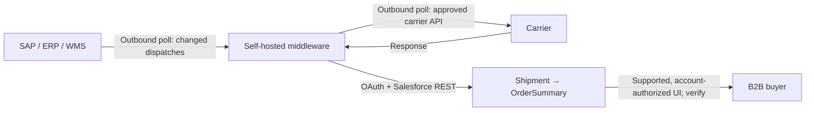

# Low-level technical design: B2B shipment tracking, twice daily

**Status:** architecture draft for review, 11 November 2026. **Scope:** the complete originating specification includes both batch jobs, carrier options, storefront exposure and non-functional requirements. Exact ERP/carrier contracts, source IDs, DST and missed-run behavior, security model, middleware and operational SLAs remain unverified. The detailed implementation is a proposal. Section 11 reconciles the recovered requirements. The companion delivery story has epics, acceptance criteria and definitions of done. The design is a proposal; implementation and acceptance are NOT RUN.

## 1. Goals, boundaries and decisions

Middleware polls ERP/WMS for shipment dispatch changes and polls supported carrier status sources twice daily, then upserts Salesforce `Shipment` data. The batch process initiates outbound connections; no inbound public webhook is required. `0 7,19 * * *` means 07:00 and 19:00 in the scheduler's configured time zone. **Time zone:** `America/New_York` (Eastern Time). Daylight-saving and catch-up behavior remain to be tested and decided. All stored event times and watermarks are UTC, with source timezone and precision captured when provided.

SAP remains the production source of record for fulfillment and post-order servicing. The integration publishes a Salesforce buyer-facing projection and does not change SAP ownership. The user's MVP defers creation of `FulfillmentOrder` and `ShipmentItem`; existing records are not removed. This means the proposed shipment-only projection does **not** by itself establish per-item shipped quantities, order lifecycle advancement, returns, invoicing or partial-fulfillment rollups. Treat those as outside this MVP unless requirements expand. The separate internal Salesforce demo uses fulfillment and shipment items; it is evidence, not a mandatory implementation dependency or a source of approval.

### Platform and design gates

1. **Parent lookup:** Salesforce documents `Shipment.OrderSummaryId` and `Shipment.FulfillmentOrderId` as nullable references. The checked Salesforce field reference has no `Shipment.OrderId`. An `Order`-only fallback cannot be implemented by simply passing `OrderId`; prove a supported order-only design or explicitly adopt an approved alternative. B2B Commerce can use Order Summaries independent of a full Salesforce Order Management deployment; establish the org's actual license and summary behavior rather than equating the two. See Shipment object and Shipment field reference.
2. **Order number:** `OrderSummary.OrderNumber` is the order summary number; the original `Order.OrderNumber` is a different identifier. Never assume the ERP value is interchangeable. Establish its canonical source and uniqueness scope, including store and tenant. Existing docs show a relationship through `OriginalOrderId`; inspect actual identifier values and field visibility before choosing a query. See OrderSummary.
3. **Display:** existing the target project Builder inspection found the standard Shipment Tracking component configured with `{!Order.Details.status}`—an order-status expression, not verified per-shipment binding. Salesforce's LWR component guide describes a tracker of up to five statuses, not proof of a multi-package carrier view. Test actual fixture, viewer and component expressions; do not assume Shipment upsert updates the tracker. The order expression reference lists the observed expression.
4. **Authorization:** object/field access, external sharing, site/API behavior, effective-account access and actual buyer license must be validated. Do not assume `Shipment` supports a particular sharing set, relationship path, or buyer profile permission. Do not expose all shipments with `View All` to buyers. Native access through a supported commerce endpoint may differ from direct sObject access.
5. **Schedule and source policy:** obtain agreed source pagination, late-update retention, canonical identifiers, job/cursor ownership, carrier provider, rate limits, terms, lifecycle and error ownership. These are open dependencies; no carrier API contract or SLA is asserted here.

## 2. Logical data model and mapping



| Field / concept | Type and contract | Source / behavior |
|---|---|---|
| `Shipment.OrderSummaryId` | Standard reference; nullable at schema level. MVP ingestion requires an exact valid match by business policy. | Resolve source order reference to precisely one summary in the intended store/account. Reject missing/ambiguous; do not create an orphan. |
| `Shipment.FulfillmentOrderId` | Standard reference; optional in the checked schema. | Not created by this MVP; if source already supplies a legitimate FO, support only after lifecycle rules and parent consistency are approved. |
| `External_Tracking_Id__c` | Proposed Text(255), External ID, unique, case-insensitive. | Immutable, non-secret identity of source tenant + immutable ERP package/shipment ID. A carrier tracking number alone is not a safe immutable key. |
| `Status` | Standard configurable picklist; actual active API values/record type must be described. | Source-to-target mapping approved by human; `Created`, `Shipped`, `In Transit`, `Out for Delivery`, `Delivered`, `Exception`, `Voided` are requested values, not assumed deployed. |
| `Provider` | Standard Shipping Provider picklist, not a provider-record lookup in the checked reference. | Map carrier code using approved API values; requested UPS/FedEx/USPS/DHL/Other require org verification. |
| `TrackingNumber`, `TrackingUrl` | Standard text and URL fields, respectively. | Sanitize and validate; URL is HTTPS and approved carrier host only. Do not log full tracking numbers unless needed and approved. |
| `ExpectedDeliveryDate`, `ActualDeliveryDate` | Standard DateTime fields, not Date. | Normalize known source time to ISO-8601 UTC; do not fabricate a time from a date without an approved convention. |
| Ship date | No standard `Shipment` ship-date field was found in the checked reference; another demo chat reports creating a dedicated field. | **Inspect current org** before choosing or creating a custom field; confirm exact API name, type and timezone semantics. Never store dates in `Description` as the integration contract. |
| `Live_Tracking_Link__c` | Proposed Text formula. | See guarded draft below. Formula must compile in target org and must not be assumed usable as a clickable link in LWR. |
| Latest carrier event/time | Proposed middleware durable state; optional Salesforce fields only if UX or audit requires them. | Store carrier code, mapped status, authoritative event time, ingested time, raw-state classification and mapping version. Do not pretend `LastModifiedDate` is carrier event time. |

### External key format

Preferred human-readable stable key is an immutable ERP package ID scoped by source system and tenant. To stay within 255 characters and avoid delimiter/case collisions, proposed versioned value is `v1:` plus lowercase hex SHA-256 of UTF-8, length-prefixed components `source-system`, `source-tenant`, `immutable-package-id`. Preserve the exact key components and source identity in the restricted middleware ledger. **Case policy must match the ERP's identifier semantics:** hashing original bytes preserves distinctions even though Salesforce uniqueness is case-insensitive. Reject missing IDs; do not build an identity from mutable tracking numbers or contact data. Require collision/identity disagreement checks and an explicit migration plan if the algorithm changes.

### Proposed Salesforce metadata: external ID

The following is a **candidate** Metadata API source-format definition, not deployed or org-validated. File path `force-app/main/default/objects/Shipment/fields/External_Tracking_Id__c.field-meta.xml`. The user's desired end state is universally required. Before setting `<required>true</required>`, inventory and backfill existing shipments, check all other creation paths and test the impact; for a phased rollout start with `false`, enforce nonblank for this integration in middleware, then tighten only after an approved compatibility check. A validation rule scoped to an integration user is an alternative subject to org review.

```xml
<?xml version="1.0" encoding="UTF-8"?>
<CustomField xmlns="http://soap.sforce.com/2006/04/metadata">
    <fullName>External_Tracking_Id__c</fullName>
    <caseSensitive>false</caseSensitive>
    <description>Stable source-scoped shipment identity for idempotent integration.</description>
    <externalId>true</externalId>
    <inlineHelpText>Use the immutable source-scoped package key, not a mutable tracking number.</inlineHelpText>
    <label>External Tracking ID</label>
    <length>255</length>
    <required>true</required>
    <type>Text</type>
    <unique>true</unique>
</CustomField>
```

Confirm that this standard object supports the custom field and exact property combination in the target org. External ID and unique values are indexed; existing collisions, required-field behavior and field-level permissions need a sandbox deployment test. CustomField Metadata API; custom field attributes.

### Proposed link formula and metadata

The supplied formula embeds Markdown link syntax inside the URL strings; those strings are **not valid carrier URLs**. `Provider` is a picklist; use `TEXT(Provider)` in a text expression. Tracking numbers must be URL encoded. The request's carrier URL patterns are examples supplied by the user; they have **not** been verified with carrier owners. Replace only after confirming current public tracking URL contracts and allowed domains. This conservative draft produces no link for `Other` or missing/unknown provider; the user's requested fallback to `TrackingUrl` is a **pending design decision** because arbitrary URL content could expose buyers to untrusted domains. If that fallback is approved, validate URL scheme and host on ingestion and all other write paths before displaying it.

These public carrier patterns are examples from the source and remain unverified; DHL is outside the initial three-carrier rollout. The following candidate formula metadata must pass target-org compilation and security/UI tests. It does not assert LWR will render `HYPERLINK` as a clickable link.

```xml
<?xml version="1.0" encoding="UTF-8"?>
<CustomField xmlns="http://soap.sforce.com/2006/04/metadata">
    <fullName>Live_Tracking_Link__c</fullName>
    <description>Provides a carrier tracking link from an approved carrier pattern.</description>
    <formula><![CDATA[
IF(
  OR(ISBLANK(TrackingNumber),
     NOT(OR(ISPICKVAL(Provider, "UPS"), ISPICKVAL(Provider, "FedEx"),
            ISPICKVAL(Provider, "USPS"), ISPICKVAL(Provider, "DHL")))),
  "",
  HYPERLINK(
    CASE(TEXT(Provider),
      "UPS", "https://wwwapps.ups.com/WebTracking/track?track=yes&trackNums=" & URLENCODE(TrackingNumber),
      "FedEx", "https://www.fedex.com/fedextrack/?trknbr=" & URLENCODE(TrackingNumber),
      "USPS", "https://tools.usps.com/go/TrackConfirmAction?tLabels=" & URLENCODE(TrackingNumber),
      "DHL", "https://www.dhl.com/en/express/tracking.html?AWB=" & URLENCODE(TrackingNumber),
      ""
    ),
    "Track Package (" & TrackingNumber & ")",
    "_blank"
  )
)
    ]]></formula>
    <formulaTreatBlanksAs>BlankAsBlank</formulaTreatBlanksAs>
    <inlineHelpText>Open the approved carrier tracking page for this shipment.</inlineHelpText>
    <label>Live Tracking Link</label>
    <type>Text</type>
</CustomField>
```

Target path: `force-app/main/default/objects/Shipment/fields/Live_Tracking_Link__c.field-meta.xml`. `HYPERLINK` creates a text formula link; `URLENCODE`, `HYPERLINK`, and `TEXT` describe the functions. Validate blanks, special characters, record-type API values, link security and actual destination for every carrier. Unknown or blank data must produce a truthful unavailable state.

## 3. Identity and access

1. `[HUMAN]` Confirm target org, B2B/OrderSummary and Shipment feature entitlements; inspect `Shipment` and `OrderSummary` using the **selected API version**, target integration identity, describe, record types, current fields, sharing and automations. Existing metadata snapshots do not prove current permissions.
2. Create or reuse a supported External Client App/Connected App for OAuth 2.0 client credentials with a dedicated **run-as integration user** and API scope. Restrict the app, network and access according to org policy; store client secret in the existing secret manager and rotate it; obtain a new access token when expired. Client credentials have no interactive user session and should not be put in client-side code or logs. Confirm existing app policy before reuse. Salesforce client-credentials documentation.
3. Give the integration identity only required Shipment create/read/edit, target field access, and read access to the needed OrderSummary/Order fields. `View All` on Shipment is the user's proposed configuration; use it only if record-level tests demonstrate it is needed, and limit its use to this integration identity. Do not assign `Modify All` by default.
4. Determine buyer access through actual org-supported B2B Commerce security and account model. Do **not** assume a sharing set can traverse Shipment → OrderSummary → Account or that direct buyer CRUD is required/available. Use actual Describe/Setup, current platform docs and sandbox user tests. Enforce authorization server-side before exposing records or tracking URLs, including switched-account context. Test guessed IDs and two unrelated accounts; do not grant buyer `View All`.
5. Observe data minimization: tracking IDs and links can identify recipients and deliveries. Use restricted logs, redact tokens/secrets, mask identifiers where possible, define retention, and send no buyer notifications as an implicit batch side effect.

## 4. Middleware durable state and job semantics

Use the existing middleware's durable storage or a transactional database; the following PostgreSQL DDL is **illustrative and not a recommendation to add a new system**. `source_id`/`external_key` are restricted integration identifiers. Access and retention are operational decisions.

```sql
CREATE TABLE integration_cursor (
  stream text PRIMARY KEY,
  watermark_time timestamptz NOT NULL,
  watermark_tiebreaker text NOT NULL,
  updated_at timestamptz NOT NULL DEFAULT now()
);
CREATE TABLE shipment_work (
  source_system text NOT NULL,
  source_tenant text NOT NULL,
  source_package_id text NOT NULL,
  external_key varchar(255) NOT NULL UNIQUE,
  erp_revision text,
  erp_updated_at timestamptz,
  sf_order_summary_id varchar(18),
  sf_shipment_id varchar(18),
  work_state text NOT NULL CHECK (work_state IN ('STAGED','READY','RETRY','QUARANTINED','SYNCED')),
  attempt_count integer NOT NULL DEFAULT 0,
  next_attempt_at timestamptz,
  last_error_code text,
  correlation_id uuid NOT NULL,
  updated_at timestamptz NOT NULL DEFAULT now(),
  PRIMARY KEY (source_system, source_tenant, source_package_id)
);
CREATE TABLE carrier_event_state (
  external_key varchar(255) PRIMARY KEY REFERENCES shipment_work(external_key),
  carrier_code text NOT NULL,
  carrier_event_id text,
  carrier_event_time timestamptz,
  carrier_event_tiebreaker text,
  normalized_status text,
  mapping_version text NOT NULL,
  last_checked_at timestamptz,
  last_success_at timestamptz,
  next_check_at timestamptz
);
```

Add a secure payload store/outbox with versioned schema, retention and encryption; the abbreviated DDL is not a complete production schema. Maintain independent `erp_dispatch` extraction cursor, Salesforce write queue and carrier last-checked state. One active run per stream (lease with fencing/expiry) prevents concurrent writers. Source pages must be durably staged before a cursor advances; a failed Salesforce write can remain in a durable retry/dead-letter queue while extraction continues. If staging, checkpoint transaction or page completeness is uncertain, do **not** move past it. Per-record success never means an entire unpersisted source interval succeeded.

Use source-provided monotonic revision or `(updated_at, stable source id)` ordering, a captured upper bound, pagination, UTC and configurable overlap. The ERP must guarantee the ordering/retention semantics; timestamp-only paging risks missed records with identical timestamps or delayed updates. Use overlap plus reconciliation for late arrivals, and full periodic reconciliation if supported. Exact overlap, source latency and historical replay window are **Pending** business/source contracts. Record late-arrival rate and cursor lag.

## 5. Batch sequences

### Job A — ERP/WMS dispatch → Salesforce

1. At the configured scheduled time, acquire the fenced stream lease and obtain secrets without writing them to logs. Capture batch ID, config/mapping version and upper bound. If lease is active, record skipped overlap; missed-run catch-up is Pending.
2. Query the ERP adapter from durable watermark minus overlap through the upper bound. API endpoint/auth/pagination are **placeholders pending the actual ERP contract**. Required canonical input: `sourceSystem`, `tenant`, immutable `packageId`, `erpOrderReference`, `carrierCode`, `trackingNumber`, `shipDate`, `estimatedDeliveryDate`, source update time/revision; optional cancellation/correction. Invalid or missing required data goes to durable quarantine with redacted diagnostics.
3. Persist each complete page and update the extraction cursor transactionally once staging is confirmed. Deduplicate by stable identity and source version. Do not mark data synced or drop failed rows merely because another row succeeded.
4. Resolve `OrderSummaryId` via the agreed ERP↔Salesforce crosswalk; allow exactly one match in the intended account/store. If ERP holds the **original Order number**, look up the original Order then `OrderSummary.OriginalOrderId`; if it holds **Order Summary Number**, use `OrderSummary.OrderNumber`. Neither path establishes global uniqueness without a verified scoped contract. Paginate Salesforce query results using `nextRecordsUrl` until `done`; validate and escape any generated SOQL values or use a well-tested query builder.
5. Validate field lengths, active picklist API values, timestamps and parent links. Select external key deterministically. Build homogeneous batches of **at most 200**, `allOrNone:false`, and send to sObject Collections Upsert. Parse every result, matching response position to the submitted row. Mark only successful rows `SYNCED`; store Salesforce ID if returned. Quarantine permanent failures, retry transient failures, and reconcile ambiguous timeout via the same idempotent key before replay. HTTP 200 does not mean every row succeeded. Salesforce collection upsert.
6. Reconcile counts: source pages/items, deduplicated versions, staged, synced, retry, quarantine; alert on discrepancy/lag and preserve audit and replay evidence. Release lease. No side-effect assumption: inventory/email/flows triggered by the org must be inventoried and suppressed or isolated in test before writes.

### Job B — carrier status → Salesforce (specified; contracts pending)

1. After Job A stages/syncs eligible packages, or under a separate schedule with explicit dependency, select nonterminal and approved recheck shipments. Carrier-specific adapters poll only allowed providers under contract; no generic real endpoint or credential is assumed.
2. Normalize known carrier events using a human-approved, versioned table: `carrier`, `raw_code`, optional subcode → target Shipment status. Unknown/invalid mappings are quarantined and never guessed by an LLM. Keep raw event ID/time and a safe subset of payload for audit. If source timestamp or timezone is missing, mark uncertain; do not stamp a fabricated event time.
3. Dedupe by provider event ID/version. Compare source event times plus deterministic tie-breaker; prevent stale events overwriting newer ones. Status rank alone is insufficient: corrections, delivery exceptions, returns, void/replacement and redelivery are legitimate transitions. Approve carrier-specific correction policy; if order cannot be resolved quarantine rather than silently regressing or discarding corrections. Keep `last_success_at` distinct from event time.
4. Upsert the **same immutable external key** with approved changed fields. Establish field ownership/merge policy so ERP dispatch replay cannot overwrite newer carrier state: e.g. Job A owns parent/carrier/tracking and Job B owns carrier status/event dates; synchronize per key and define reconciliation for a carrier or tracking-number change. User-owned edits and deleted/voided packages need explicit conflict rules. Two runs are not atomic across ERP, carrier and Salesforce.
5. Retry under limits; report stale data honestly. Persist carrier failures and the last verified event without presenting polling time as a fresh delivery event. Continue scheduled polling or stop for terminal states according to agreed carrier correction/retention policy.

## 6. Illustrative API contracts

**Salesforce version:** examples use the user's `v61.0`; support and object access must be verified in the target org. IDs and tracking values below are **placeholders**, not executable records. ERP/carrier examples are canonical middleware contracts, not claims of a vendor endpoint.

### OAuth client credentials

```http
POST <salesforce-instance-url>/services/oauth2/token
Content-Type: application/x-www-form-urlencoded

grant_type=client_credentials&client_id=<secret-manager-client-id>&client_secret=<secret-manager-client-secret>
```

```json
{"access_token":"<redacted>","instance_url":"<salesforce-instance-url>","token_type":"Bearer"}
```

Use HTTPS and form encoding. Store token in process memory only; use the returned instance URL. The exact response fields, auth method and app policy must be confirmed in the selected org. Do not print secrets or tokens.

### Source dispatch contract — internal canonical form

```json
{"sourceSystem":"ERP","tenant":"tenant-a","packageId":"PKG-1001","erpOrderReference":"ERP-ORD-900","carrierCode":"UPS","trackingNumber":"EXAMPLE-TRACK-1","shipDate":"2026-11-11","estimatedDeliveryDate":"2026-11-14","updatedAt":"2026-11-11T15:00:00Z","sourceRevision":"42"}
```

`shipDate` and estimated date are dates in this example; never convert them to DateTime by inventing midnight UTC unless an approved rule defines meaning and timezone. The real ERP may supply an actual DateTime instead. Parent crosswalk, package identity and contract remain pending.

### Parent resolution — two distinct identifiers

For a verified summary number in a store/account scope, an illustrative URL-encoded SOQL query is:

```http
GET /services/data/v61.0/query?q=SELECT%20Id%2COrderNumber%2COriginalOrderId%2CAccountId%2CSalesStoreId%20FROM%20OrderSummary%20WHERE%20OrderNumber%20%3D%20%27SUMMARY-EXAMPLE%27
Authorization: Bearer <redacted>
```

```json
{"totalSize":1,"done":true,"records":[{"attributes":{"type":"OrderSummary","url":"/services/data/v61.0/sobjects/OrderSummary/<summary-id>"},"Id":"<summary-id>","OrderNumber":"SUMMARY-EXAMPLE","OriginalOrderId":"<original-order-id>","AccountId":"<account-id>","SalesStoreId":"<store-id>"}]}
```

`OrderNumber` above is a summary number. For ERP original-order number: first resolve `Order.OrderNumber` under its verified uniqueness scope, then query `OrderSummary` by the resulting `OriginalOrderId`, scope to expected account/store and require exactly one candidate. The actual ERP order reference may instead require a dedicated crosswalk; do not silently substitute one identity. Handle `done:false` / `nextRecordsUrl` and zero/multiple matches.

### Salesforce sObject Collections upsert

```http
PATCH /services/data/v61.0/composite/sobjects/Shipment/External_Tracking_Id__c
Authorization: Bearer <redacted>
Content-Type: application/json
```

```json
{"allOrNone":false,"records":[{"attributes":{"type":"Shipment"},"External_Tracking_Id__c":"v1:<64-hex-key>","OrderSummaryId":"<summary-id>","Provider":"UPS","Status":"Shipped","TrackingNumber":"EXAMPLE-TRACK-1"}]}
```

The key and ID placeholders, `Provider`, and status must be replaced with validated org values. Omitted `ExpectedDeliveryDate` illustrates that a date-only value needs a decided conversion contract. Salesforce response is an ordered array; verify actual response in sandbox:

```json
[{"id":"<shipment-id>","success":true,"created":true,"errors":[]}]
```

Mixed result example, two records submitted in order:

```json
[{"id":"<shipment-id>","success":true,"created":false,"errors":[]},{"id":null,"success":false,"created":false,"errors":[{"statusCode":"INVALID_OR_NULL_FOR_RESTRICTED_PICKLIST","message":"Invalid status value","fields":["Status"]}]}]
```

Correlation from each position back to the durable work row is mandatory. This endpoint accepts no `Id` in an upsert record; the specified external ID field selects the record. A whole-request malformed 400 differs from HTTP 200 with row failures. Confirm exact error codes and response in the selected org; never hard-code this illustrative message as a parser.

### Carrier canonical event — not a carrier API

```json
{"carrier":"UPS","packageId":"PKG-1001","trackingNumber":"EXAMPLE-TRACK-1","eventId":"EVENT-77","eventCode":"<carrier-code>","eventTime":"2026-11-12T14:35:00Z","ingestedAt":"2026-11-12T19:00:00Z","mappingVersion":"v1"}
```

The real carrier's endpoint, auth, request/response schema, polling limits, tracking links and commercial terms are pending. Never claim this envelope is the carrier's wire format.

## 7. Error handling and recovery

| Condition | Handling | Checkpoint / operator outcome |
|---|---|---|
| ERP timeout, paging failure, missing page | Bounded exponential backoff with jitter; honor source retry hints. | Do not advance extraction cursor past an unstaged/uncertain page; alert after agreed limit. |
| 401 Salesforce | Refresh client-credentials token once; retry once. | If still failing, pause writes and notify integration owner; no repeated secret exposure. |
| 403 Salesforce | Quarantine/pause according to scope, capture sanitized permission evidence. | Do not repeatedly retry authorization errors or widen permissions automatically. |
| Salesforce 429, 5xx, timeout | Honor `Retry-After` when supplied, backoff with jitter and bounded retry. | On timeout after possible commit, reconcile/upsert same external key; retain uncertain row durably. |
| HTTP 200 with row errors | Inspect every result; independently handle success, retryable and permanent failures. | Persist successful IDs; quarantine validation errors, replay only eligible rows. |
| Missing/duplicate parent or key mismatch | Quarantine; no guessed parent or orphan. | Route to business/data owner; replay after correction using same key. |
| Unknown carrier code/status, bad URL | Do not publish an invented status/link; retain event for mapping review. | Keep prior verified status and freshness; alert owner. |
| Old, duplicate, or contradictory event | Dedupe; compare source time/version and correction rules. | Prevent accidental rollback; quarantine ambiguous corrections; retain audit. |
| Permanent validation / restricted picklist | Capture sanitized error, source ID and mapping version. | Dead-letter with owner and correction/replay procedure; no endless retry. |
| Failed cursor/lease transaction or worker crash | Resume from last durable stage/cursor; fenced lease prevents stale worker commit. | Reconcile source and destination before declaring completion. |

The precise retry counts, delay caps, queue retention, paging/reconciliation windows, escalation channel, recovery objectives, dead-letter service level and who can replay are **Pending** operational decisions. Recommended starting point for sandbox: at most five transient attempts, exponential backoff capped at 15 minutes and alert when exhausted; these are proposals, not production SLAs.

## 8. Storefront configuration and buyer acceptance

1. `[HUMAN]` In sandbox, inventory current page and version; the target project already has Shipment Tracking on **Order Summary Details** bound to `{!Order.Details.status}`. Record settings and coordinate any shared-page changes. Do not assume Editor sample data reflects an actual order.
2. With a separately approved synthetic order and populated shipment, inspect standard components and supported data sources. Determine whether they can display each `Shipment`'s carrier, tracking number/link, status and freshness, including two shipments with different statuses. Check if formula links render safely; Salesforce order expressions alone do not demonstrate a Shipment binding.
3. If native components and supported configuration meet the criteria, configure labels, empty, error and stale states, accessibility and responsive layout. Never display sample progress as actual carrier status. If not, document the gap and obtain a scope decision for an appropriate supported alternative; a custom component may require separate authorization and security design. No fabricated point-and-click steps are promised.
4. Test in preview and approved runtime with Buyer A, Buyer B, switched accounts and direct-ID access; include no shipment, missing/unknown carrier, `Other`, unknown status, multiple shipments with differing states, stale event, void, tracking URL safety, accessibility and failure. Verify account context server-side and make sure no cross-account data is returned. Test alerts and notifications in controlled sandbox. Publish only under a separate authorized release plan.

## 9. Verification and deployment sequence

1. **Discovery gate:** describe org object, fields, record types and picklists using selected API/integration user; inventory existing Salesforce automation, shipment data, current auth app, internal layout, and buyer sharing. Identify existing ship-date field being created by the separate demo chat before introducing another field. Capture permissions and API access evidence.
2. **Contract gate:** ERP field values, source ID stability, order key and uniqueness scope, pagination, carrier APIs/mapping, time zone/DST, frequency, backlog/latency, void/replacements, exception ownership and source replay guarantees agreed. Determine whether buyer-visible per-item tracking is necessary; if so the phase-2 deferral may not satisfy it.
3. **Sandbox metadata:** create unique External ID with staged requiredness, configure picklists and link formula only if supported; deploy validation/check-only first. Backfill existing data and test integrations/other writers before enforcing universal required. Snapshot metadata and agree rollback. Formula link patterns and `Other` handling require security and owner approval.
4. **Synthetic integration:** simulate paged source changes and replay; test duplicate same-key updates, two shipments per order, cross-store duplicate order numbers, no match, partial batch error, HTTP 200 mixed results, network timeout after commit, 401/403/429/5xx, old carrier event, duplicate event, correction, carrier outage and safe link encoding. Show ledger/cursor invariants and no real notification, shipment, or payment.
5. **Buyer proof and security:** independently test the approved fixture and unauthorized account, plus no-shipment and stale cases. Compare Salesforce records, middleware ledger and actual rendered UI. If tracker shows order-level state rather than package status, do not mark per-shipment acceptance complete.
6. **Operational handoff:** runbook, dashboards, reconciliation, failure alert routing and tested replay/rollback; capture per-source credentials ownership and access review. Deploy and publish only with the existing release authorization. Rollback disables schedules and revokes app access as approved, preserves ledger/diagnostics, and reverts metadata/UI only after considering populated values and dependent writers; do not delete shipments as an automatic rollback. Repair/replay after reconciliation.

## 10. Open decisions and source evidence

- Initial carriers are UPS, FedEx and USPS. Exact API contracts and approved status mappings remain pending.
- DST/missed-run semantics; ERP and carrier adapter/provider, volume, SLA, retention and escalation channel.
- Immutable ERP package ID contract; whether ERP reference is the original Order number, summary number, Salesforce ID, or separate crosswalk; uniqueness across stores/accounts and handling late arrivals.
- Order-only mode feasibility; whether excluding FulfillmentOrder/ShipmentItem is acceptable for required line-level fulfillment visibility.
- Verified target-org picklist API values, ship-date field, custom-field deployability, formula carrier patterns, permissions, sharing and integration app configuration.
- Whether standard Shipment Tracking can display each Shipment and whether formula links are usable in the buyer LWR surface; validate with a suitable synthetic fixture.
- Safe handling of `Other`/untrusted URLs, carrier corrections, shipment replacement/void, overwrites across Job A/B, source-vs-Salesforce precedence, retention and security review.

Sources: [Shipment object](https://developer.salesforce.com/docs/platform/object-reference/references/standard-objects/object-shipment.html), [sObject Collections upsert](https://developer.salesforce.com/docs/platform/api-rest/guide/resources-composite-sobjects-collections-upsert.html), [CustomField metadata](https://developer.salesforce.com/docs/platform/api-metadata/references/meta-types/metadata-customfield.html), and [FedEx tracking](https://developer.fedex.com/api/en-us/catalog/track/v1/docs.html). Some Salesforce pages are JS-rendered; the linked object and collection references were retrieved via searchable official excerpts and local Salesforce schema references. Target-org capability and actual carrier API behavior remain unverified.

## 11. Full specification reconciliation — Job B and request budget

The source chat contains the complete specification through non-functional requirements. Earlier statements in this draft that Job B was absent are historical drafting errors; this section supersedes them. Job A is `0 7,19 * * *`; Job B is `15 7,19 * * *`, Eastern timezone selected; DST and dependency behavior pending. Job B reads Salesforce open shipments (`Status NOT IN (Delivered, Voided)` with tracking number), follows `nextRecordsUrl` and groups by provider. Terminal exclusion may hide post-delivery corrections; explicit reconciliation policy is pending. A fixed 15-minute offset is not proof Job A finished. POC assumption: if Job A has not completed its required staged/synchronized work for that window, Job B skips or queues the dependent poll and records an alert; exact catch-up timing and recovery policy require an owner decision. This is unimplemented and must be tested.

The user's candidates are direct FedEx POST `/track/v1/trackingnumbers` (official documentation describes up to 30 tracking numbers), UPS GET `/api/track/v1/details/{inquiryNumber}`, or self-hosted Karrio POST `/v1/trackers`. These are candidate endpoints, not verified vendor contracts or a decision to create tracker resources repeatedly. Check actual vendor version, credentials, response, licensing, limits, existing middleware, privacy and refresh behavior before implementation. FedEx documents an authenticated-delivery exception requiring a secured flow; retain and escalate instead of inventing status. FedEx tracking documentation; Karrio documentation.

User-suggested `OC`/Order Processed/Picked Up → Shipped, `IT` → In Transit, `OD` → Out for Delivery, `DL` → Delivered, `EX`/`DE` → Exception are unverified cross-carrier examples; do not conflate order processed with physical pickup without carrier evidence and approval. Optional runtime LLM classification is a proposal; quarantine unknowns in this conservative design until owner decides. Populate ActualDeliveryDate only from reliable carrier delivery time. Compare all owned writable fields, including actual delivery date and approved corrections, rather than only status and estimated date, then omit unchanged rows.

For changed rows, the requested alternative to Job A upsert is `PATCH /services/data/v61.0/composite/sobjects` with `allOrNone:false` and `records:[{attributes:{type:Shipment},Id:<shipment-id>,Status:Delivered,ActualDeliveryDate:<timestamp>}]`; parse every ordered SaveResult and recover uncertain commits. The design must establish how this update and the proposed external-ID upsert interact; neither changes identity or permits stale state. The user requests at most five Salesforce REST requests per run for up to 800 active shipments: ideal Job B requires one unpaginated query and four update chunks when all 800 change. Authentication, query pagination, retries, reconciliation and Job A parent resolution can exceed that bound; agree counting and behavior under these conditions before claiming compliance. Do not skip rows or suppress recovery to satisfy a numerical target. Measure each request in tests and surface overruns.

For every failed SaveResult, retain identifier, encrypted/protected payload or safe reference, Salesforce status code/message and batch correlation, and issue an actionable summary to the selected Slack/email/Linear/Sentry destination. Destination, ownership, privacy/retention and retry policy are pending. Do not log credentials or send unrestricted payloads in alerts.

## 12. User clarification — initial rollout

US carriers are UPS, FedEx and USPS. Run Job A at 07:00 and 19:00, Job B at 07:15 and 19:15, using IANA timezone `America/New_York`; implement and test DST and missed-run policy, still to be decided. Store the tracking link on the Salesforce Shipment record associated with the order data model, and expose the buyer's own shipments on the storefront according to Salesforce access rules. Confirm supported field/formula, link rendering, Salesforce sharing and account isolation in the target org. Access to the Salesforce record does not itself restrict a carrier-hosted URL once shared.

## Current decisions

Initial US carriers: UPS, FedEx and USPS. Jobs use Eastern Time (`America/New_York`). Store the tracking link on the Shipment record subject to target-org field validation; buyers see their own shipments under Salesforce access rules. Client and instance-specific context is excluded from this file. The earlier revision 0.1 review predates these decisions; a later sanitized-document review is recorded in the story. Runtime verification remains NOT RUN.

## Public source reference index

These public source references are retained for traceability. Retrieval and applicability to the selected version and org must be checked before implementation; linking does not prove support.

- [1](https://developer.salesforce.com/docs/platform/object-reference/references/standard-objects/object-shipment.html)
- [2](https://developer.salesforce.com/docs/platform/field-reference/references/field-reference/salesforce-field-reference-shipment.html)
- [3](https://developer.salesforce.com/docs/platform/object-reference/references/standard-objects/object-ordersummary.html)
- [4](https://help.salesforce.com/s/articleView?id=commerce.comm_components.htm&language=en_US&type=5)
- [5](https://help.salesforce.com/s/articleView?id=commerce.comm_components_expressions_order.htm&language=en_US&type=5)
- [6](https://developer.salesforce.com/docs/platform/api-metadata/references/meta-types/metadata-customfield.html)
- [7](https://help.salesforce.com/s/articleView?id=sf.custom_field_attributes.htm&language=en_US&type=5)
- [8](https://help.salesforce.com/s/articleView?id=platform.customize_functions_urlencode.htm&language=en_US&type=5)
- [9](https://help.salesforce.com/s/articleView?id=platform.customize_functions_hyperlink.htm&language=en_US&type=5)
- [10](https://help.salesforce.com/s/articleView?id=platform.customize_functions_text.htm&language=en_US&type=5)
- [11](https://help.salesforce.com/s/articleView?id=sf.remoteaccess_oauth_client_credentials_flow.htm&type=5)
- [12](https://developer.salesforce.com/docs/platform/api-rest/guide/resources-composite-sobjects-collections-upsert.html)
- [13](https://help.salesforce.com/s/articleView?id=commerce.om_shipment_fields.htm&language=en_US&type=5)
- [14](https://developer.fedex.com/api/en-us/catalog/track/v1/docs.html)
- [15](https://docs.karrio.io/)
